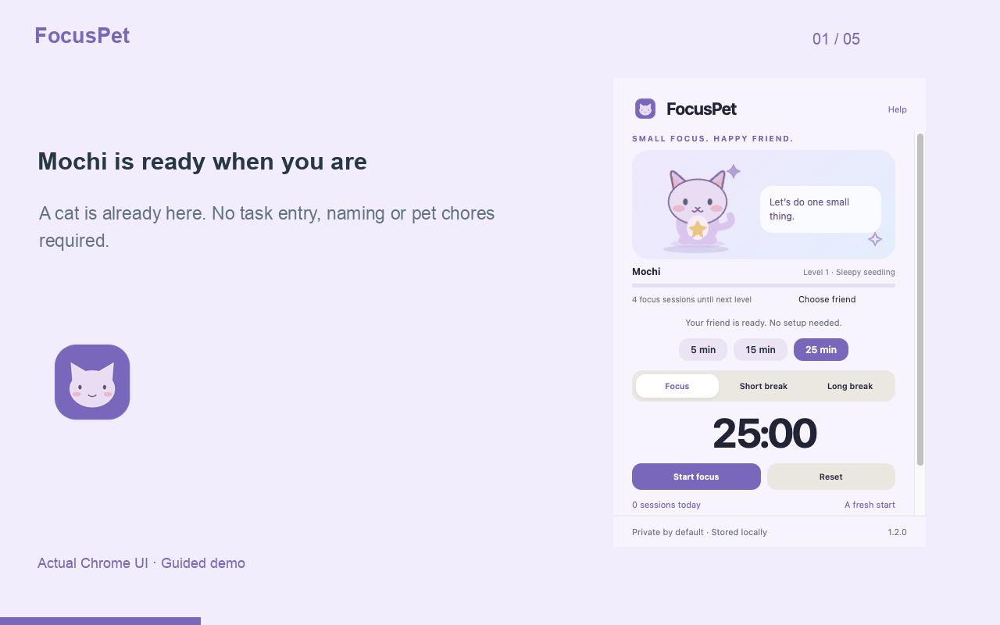

# FocusPet walkthrough

Watch the [MP4 demo](walkthrough.mp4) or the animated walkthrough below. These are guided captures of the actual Chrome extension UI, using a disposable profile and fictional example URLs. The video advances between action frames; it is not continuous screen recording.

## 1. Meet your focus friend

Choose a tiny cat or bunny. Your companion stays inside the extension.

## 2. Make the companion yours

Pick a bunny and give it a name.

## 3. Start one small task

The timer continues after you close the popup.

## 4. Pause when you need to

Resume, reset, or choose a break. Switching modes stops the current timer.

## 5. Completed sessions help your friend grow

Demo fast-forward: three prior sessions are seeded and this timer ends early.

## 6. See your weekly rhythm

Adjust durations and see recent focus counts. Progress stays on your device.

## Timing disclosure

Completion demo seeds three prior focus sessions and a 500 ms deadline; no real 25-minute wait.
